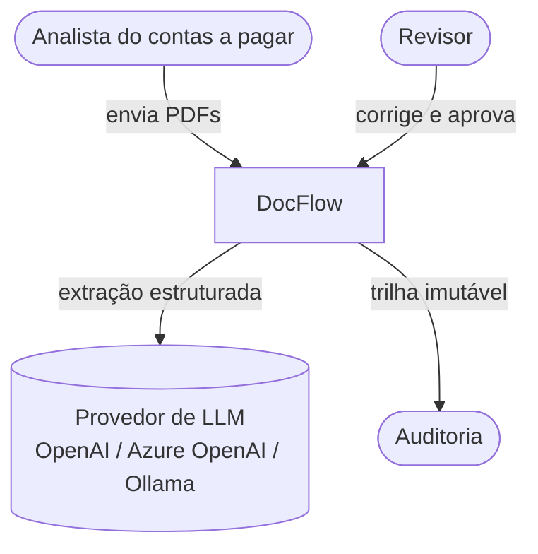
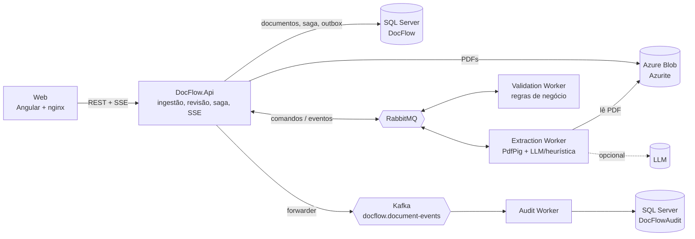
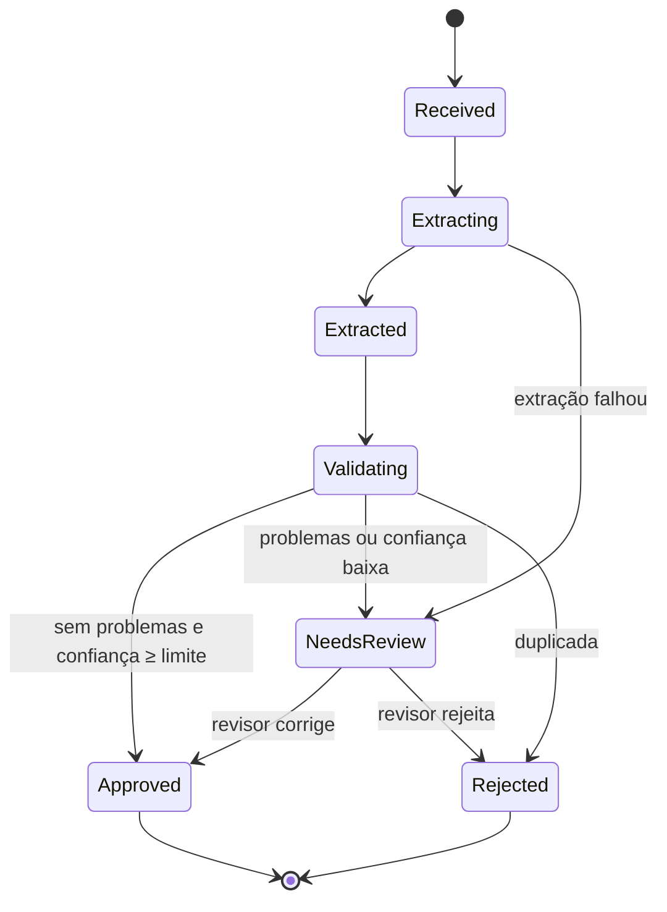
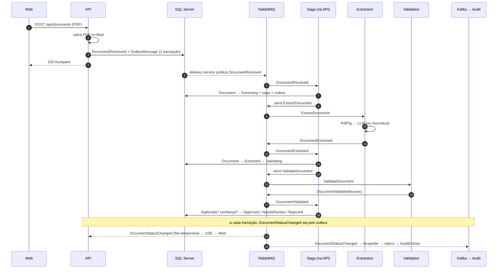
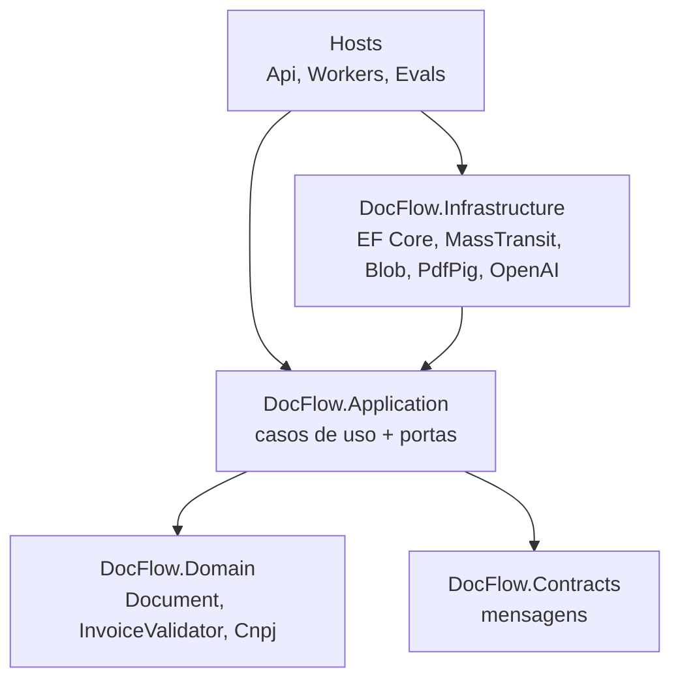

# 02 - Arquitetura

## Contexto (C4 nível 1)

## Containers (C4 nível 2)

| Container | Responsabilidade | Estado |
|---|---|---|
| **DocFlow.Api** | Upload, consultas, revisão, saga e SSE | Dono do agregado `Document` e da saga |
| **Extraction Worker** | Lê o PDF do blob, extrai texto e campos | Nenhum |
| **Validation Worker** | Aplica as regras do domínio | Nenhum |
| **Audit Worker** | Consome o Kafka e grava a trilha | Banco próprio |
| **Web** | Upload, lista ao vivo e tela de revisão | — |

A justificativa de juntar ingestão, revisão e orquestração na API está na [ADR 0002](adr/0002-dono-unico-do-agregado.md).

## Máquina de estados do documento

As transições permitidas ficam em `Document.AllowedTransitions`. Qualquer outra lança `InvalidTransitionException`.

## Fluxo de um documento

## Camadas (Clean Architecture + DDD)

| Projeto | Conteúdo |
|---|---|
| `DocFlow.Domain` | Agregado `Document` com máquina de estados, `InvoiceData`, `InvoiceValidator`, `Cnpj`. Não depende de nada. |
| `DocFlow.Contracts` | Records das mensagens, nomes de filas e tópicos. Não depende do domínio: o contrato entre serviços evolui separado do modelo interno. |
| `DocFlow.Application` | `DocumentIngestion`, `DocumentWorkflow`, `DocumentReview` e as portas (`IDocumentRepository`, `IUnitOfWork`, `IDocumentStorage`, `IMessagePublisher`, `IInvoiceExtractor`, `IPdfTextReader`). |
| `DocFlow.Infrastructure` | Adaptadores: EF Core (`DocFlowDbContext`, repositório/UoW, migrations), MassTransit (saga, activities, consumers, outbox), Blob, PdfPig, OpenAI, heurística. |
| `DocFlow.Samples` | Gerador de notas fictícias com QuestPDF em 3 layouts e 3 cenários, sempre com gabarito. |
| `DocFlow.Evals` | Mede a acurácia por campo e por layout. |

### Decisões de modelagem

- **`InvoiceData` como value object (record) persistido em JSON** (`InvoiceJson`, `IssuesJson`, `HistoryJson`). O documento é sempre lido e gravado inteiro. Não há consulta por item, então tabelas filhas seriam custo sem benefício.
- **`DuplicateKey` desnormalizado** (CNPJ + número sem zeros à esquerda), com índice, para a checagem de duplicidade não precisar abrir o JSON.
- **Concorrência otimista** com `RowVersion` no documento e na saga: a revisão humana e um evento atrasado nunca sobrescrevem um ao outro em silêncio.
- **`TimeProvider` injetado** em tudo que usa data, o que deixa os testes determinísticos.

## Segurança e limites

- Upload só aceita `.pdf` de até 10 MB.
- Containers .NET rodam com o usuário `app`, sem root.
- Strings de conexão e chaves vêm de variáveis de ambiente, nunca do código. O `appsettings.json` só tem valores de desenvolvimento local.
- O texto enviado ao LLM é truncado em 12 mil caracteres.

## Decisões registradas

| ADR | Decisão |
|---|---|
| [0001](adr/0001-saga-orquestrada.md) | Saga orquestrada com state machine do MassTransit |
| [0002](adr/0002-dono-unico-do-agregado.md) | A API é dona do agregado; workers são stateless |
| [0003](adr/0003-outbox-e-idempotencia.md) | Transactional outbox e idempotência em camadas |
| [0004](adr/0004-rabbitmq-e-kafka.md) | RabbitMQ para o workflow, Kafka para auditoria |
| [0005](adr/0005-extracao-llm-com-fallback.md) | LLM com saída estruturada, fallback heurístico e humano no loop |
| [0006](adr/0006-masstransit-8-e-docker.md) | MassTransit 8.x (licença) e Docker como única dependência |
