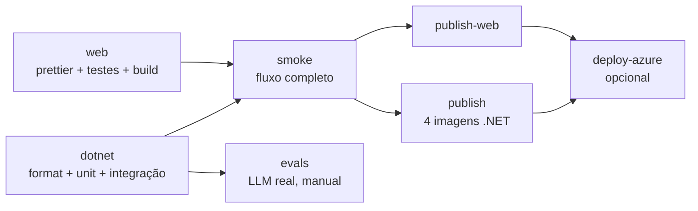

# 04 - Pipeline de CI/CD

Este guia explica a pipeline do DocFlow: o que cada job faz, por que existe, como configurar no GitHub e como publicar no Azure.

Arquivo: [`.github/workflows/ci.yml`](../.github/workflows/ci.yml)

## Princípio

Nenhum job instala .NET ou Node. Tudo roda com `docker compose`, exatamente como no meu terminal. A pipeline é só uma forma automática de rodar os mesmos comandos.

## Visão geral



| Evento | O que roda |
|---|---|
| Pull request | `dotnet`, `web` e `smoke` |
| Push na `main` | Os anteriores, mais `publish`, `publish-web` e `deploy-azure` se estiver habilitado |
| Execução manual (Run workflow) | Os anteriores; `evals` se a opção for marcada |

`concurrency` cancela execuções antigas da mesma branch quando chega um commit novo.

## Os jobs, um a um

### `dotnet`

```bash
docker compose --profile test run --rm --build dotnet-test
```

1. O compose sobe **SQL Server** e **RabbitMQ** reais e espera os *healthchecks*.
2. Constrói o stage `test` do [Dockerfile](../Dockerfile): restore com cache, depois `dotnet build -c Release`.
3. O comando do container roda:
   - `dotnet format --verify-no-changes`, que falha se algum arquivo estiver fora do padrão do `.editorconfig`;
   - `dotnet test`: os testes unitários (domínio, saga com `ITestHarness`, consumers, extratores) e os de integração (`DOCFLOW_SQL` e `DOCFLOW_RABBIT` estão definidos, então eles não são pulados).
4. `if: always()` derruba tudo com `down -v`, mesmo em falha.

### `web`

```bash
docker compose --profile test run --rm --build --no-deps web-test
```

Roda `prettier --check`, os testes do Angular (Vitest) e o `ng build` de produção, que também valida os *budgets* de tamanho.

### `smoke`

Sobe a stack inteira com `docker compose up -d --build --wait` e prova o comportamento de ponta a ponta com [`scripts/smoke.sh`](../scripts/smoke.sh):

| Cenário | Esperado |
|---|---|
| Nota válida, layout clássico | `Approved` sozinha |
| Total errado | `NeedsReview` |
| CNPJ inválido | `NeedsReview` |
| Reenvio do mesmo PDF já aprovado | `Rejected` (duplicada) |
| Rejeição pelo revisor | `Rejected` |
| `GET /api/documents/events` | Responde 200 em SSE |

Depois o job confere duas coisas que só existem com a infraestrutura real:

- **A trilha de auditoria chegou via Kafka:** conta as linhas de `DocFlowAudit.dbo.AuditEntries`.
- **Nenhuma fila `_error` tem mensagens:** se alguma tiver, algum consumer falhou depois de esgotar os retries.

Sem `LLM_BASE_URL`, a extração usa a heurística, então o smoke não custa nada e não depende de serviço externo.

### `evals` (manual)

Roda o `DocFlow.Evals`, que gera 18 notas (6 por layout) com gabarito, extrai com a heurística e com o LLM e imprime a acurácia por campo e por layout. Falha se a acurácia do LLM ficar abaixo de `EVALS_MIN_ACCURACY` (85%).

É manual porque custa dinheiro e porque resposta de LLM varia: não deve bloquear todo PR.

### `publish` e `publish-web` (só na `main`)

Publicam cinco imagens no GitHub Container Registry, cada uma com as tags `latest` e o SHA do commit:

```
ghcr.io/guilhermesilva97/docflow/api
ghcr.io/guilhermesilva97/docflow/extraction
ghcr.io/guilhermesilva97/docflow/validation
ghcr.io/guilhermesilva97/docflow/audit
ghcr.io/guilhermesilva97/docflow/web
```

O mesmo Dockerfile serve aos quatro serviços .NET via `build-args: PROJECT=...` na matrix. `cache-to: type=gha` reaproveita camadas entre execuções.

### `deploy-azure` (desligado por padrão)

Só roda se a variável `AZURE_DEPLOY_ENABLED` for `true`. Faz login no Azure com **OIDC** (sem senha guardada no GitHub) e atualiza cada Container App para a imagem do commit.

## Configuração no GitHub, passo a passo

### 1. Subir o repositório

```bash
git init
git add .
git commit -m "feat: estrutura inicial do DocFlow"
git branch -M main
git remote add origin https://github.com/guilhermesilva97/docflow.git
git push -u origin main
```

### 2. Permissões de pacotes

**Settings → Actions → General → Workflow permissions**: deixe *Read repository contents and packages permissions*. Só os jobs de publish pedem `packages: write`. Depois da primeira publicação, torne os pacotes públicos em **Packages → (pacote) → Package settings → Change visibility**.

### 3. Evals (opcional)

**Settings → Secrets and variables → Actions**

| Tipo | Nome | Exemplo |
|---|---|---|
| Secret | `LLM_API_KEY` | `sk-...` |
| Variable | `LLM_BASE_URL` | `https://api.openai.com/v1` (padrão) |
| Variable | `LLM_MODEL` | `gpt-4o-mini` (padrão) |

Para rodar: **Actions → CI → Run workflow →** marque *Rodar evals de extração com LLM real*.

### 4. Proteção da `main`

**Settings → Branches → Add rule** (ou *ruleset*), exigindo PR e os checks:

- `.NET (format + unit + integração)`
- `Angular (prettier + testes + build)`
- `Smoke test do fluxo completo`

## Deploy no Azure (Container Apps)

O desenho de produção que eu usaria:

| Local | Azure |
|---|---|
| SQL Server 2022 | Azure SQL Database |
| Azurite | Azure Storage (Blob) |
| RabbitMQ | RabbitMQ em Container App, ou Azure Service Bus trocando o transporte do MassTransit |
| Kafka | Azure Event Hubs com endpoint Kafka |
| Ollama | Azure OpenAI |
| `api`, workers, `web` | Um Container App cada, no mesmo Container Apps Environment |

### Criar a infraestrutura (uma vez)

```bash
az group create -n docflow-rg -l brazilsouth
az containerapp env create -n docflow-env -g docflow-rg -l brazilsouth

for app in api extraction validation audit web; do
  az containerapp create -n docflow-$app -g docflow-rg --environment docflow-env \
    --image ghcr.io/guilhermesilva97/docflow/$app:latest
done

az containerapp ingress enable -n docflow-web -g docflow-rg --type external --target-port 80
az containerapp ingress enable -n docflow-api -g docflow-rg --type internal --target-port 8080
```

As variáveis de ambiente são as mesmas do `docker-compose.yml`, por exemplo `ConnectionStrings__DocFlow`, `RabbitMq__Host` e `Llm__BaseUrl`. Configure-as com `az containerapp update --set-env-vars` e, para valores sensíveis, `--secrets`.

### Liberar o GitHub para fazer deploy (OIDC)

1. Crie um *App Registration* no Entra ID e adicione uma **federated credential** para `repo:guilhermesilva97/docflow:environment:production`.
2. Dê a ele o papel **Contributor** no resource group `docflow-rg`.
3. No GitHub, crie o *environment* `production` (pode exigir aprovação manual) e configure:

| Tipo | Nome |
|---|---|
| Secret | `AZURE_CLIENT_ID`, `AZURE_TENANT_ID`, `AZURE_SUBSCRIPTION_ID` |
| Variable | `AZURE_RESOURCE_GROUP` = `docflow-rg` |
| Variable | `AZURE_DEPLOY_ENABLED` = `true` |

A partir daí, todo merge na `main` que passar no smoke vira deploy, e o rollback é rodar `az containerapp update` com o SHA anterior.

## Reproduzindo localmente

| Job | Comando |
|---|---|
| dotnet | `docker compose --profile test run --rm --build dotnet-test` |
| web | `docker compose --profile test run --rm --build --no-deps web-test` |
| smoke | `docker compose up -d --build --wait` e depois `docker run --rm --network docflow_default -v "$(pwd)/scripts:/s" curlimages/curl sh /s/smoke.sh http://web` |
| evals | `docker compose --profile evals run --rm --build evals` |
| limpar | `docker compose --profile test --profile evals down -v` |

Para validar o YAML do workflow:

```bash
docker run --rm -v "$(pwd):/repo" -w /repo rhysd/actionlint:latest .github/workflows/ci.yml
```

## Problemas comuns

| Sintoma | Causa provável | Solução |
|---|---|---|
| `dotnet format` falha | Arquivo fora do padrão | `docker run --rm -v "$(pwd):/src" -w /src mcr.microsoft.com/dotnet/sdk:10.0 dotnet format DocFlow.slnx` |
| SQL Server sai com código 137 | Pouca memória para o container | O SQL Server precisa de cerca de 2 GB; feche outras stacks ou aumente a memória do Docker |
| Smoke fica em `Extracting` | Worker de extração não subiu | `docker compose logs extraction` |
| Documento não aparece ao vivo | Proxy bufferizando o SSE | Confira `proxy_buffering off` no `nginx.conf` |
| `publish` falha com `denied` | Permissão de pacotes | Revisar o passo 2 |
